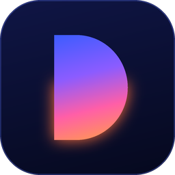

  

<h1 align="center">Denominator</h1>

<b>Plan · Learn · Grow</b> A calm, free Android app to plan your day, remember what you learn, and spend less time on your phone.

  <a href="https://wallchemist.github.io/denominator-app/download/Denominator.apk"><b>⬇ Download for Android (APK, 23 MB, most phones)</b></a> 
  Version 1.15.0 · Android 7 or newer

---

## What it does

| | |
|---|---|
| **Daily brief** | Opens with a greeting, how your day looks, what's next, and a quote that fits the day. |
| **Plan your day** | Today, your Top 3, schedule and calendar in one card. Plan tomorrow in 3 minutes with AI. Recurring tasks and checklists. |
| **Learn from anything** | Share a YouTube video, article, photo or screenshot. The AI writes a short study note with highlighted key ideas, a picture, and diagrams (flowcharts, comparison tables, charts, timelines). Switch any note between Bangla and English. |
| **Remember it** | Saved notes come back as gentle notifications: a day, 3 days, a week and a month later. |
| **Note groups** | Notes sort themselves by topic (study, faith, science, health, money…). Make your own groups too. |
| **Ideas feed** | Ten good ideas a day: quotes, book lessons, study tips and fresh science news. |
| **Focus** | Daily limits for distracting apps and a calm breathing pause before they open. |
| **Assistant** | Ask it to plan your day, quiz you on a note, or limit an app, in English or Bangla. |
| **Widgets & sync** | Home-screen widgets. Optional Google sign-in syncs across phones and lets you connect Claude. |

## Install

1. On your Android phone, open the **[download link](https://wallchemist.github.io/denominator-app/download/Denominator.apk)**.
2. When the download finishes, tap it. If Android asks, allow **Install unknown apps** for your browser or Files app, then tap **Install**.
3. If Google Play Protect shows a warning, tap **More details → Install anyway**. (It does this for any app that isn't from the Play Store.)
4. Open Denominator and follow the short setup.

**Updating:** download the new APK from the same link and install it over the old one. Your data stays.

## The free AI key

Notes, diagrams, planning and the assistant use Google Gemini with your own free key:

1. Go to **[aistudio.google.com/apikey](https://aistudio.google.com/apikey)** and sign in with Google.
2. Tap **Create API key** and copy it.
3. Paste it in Denominator (during setup, or later in **Settings → AI**).

Everything else (tasks, your own notes, Focus, the brief) works without a key.

## Permissions, explained

| Permission | Why |
|---|---|
| Notifications | Task reminders, note reminders, "your note is ready". |
| Calendar | Shows your events and plans around them. Optional. |
| Usage access + Display over other apps | Only for Focus: to see when a limited app opens and show the pause screen. |
| Accessibility is **not** used | — |

## Privacy

Your data lives on your phone. Signing in is optional and only syncs your own tasks and notes to your account. No ads, no tracking. Read the full **[privacy policy](https://wallchemist.github.io/denominator-app/privacy.html)** and **[terms](https://wallchemist.github.io/denominator-app/terms.html)**.

## Help

Questions, bugs or ideas: **ahmadintisar270@gmail.com**

Check the download: SHA-256 `6e2562eb83c962af219b6659e403b3567ab245af6e6e5fa4ba5f65b95665178d`
